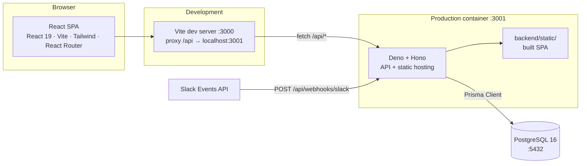
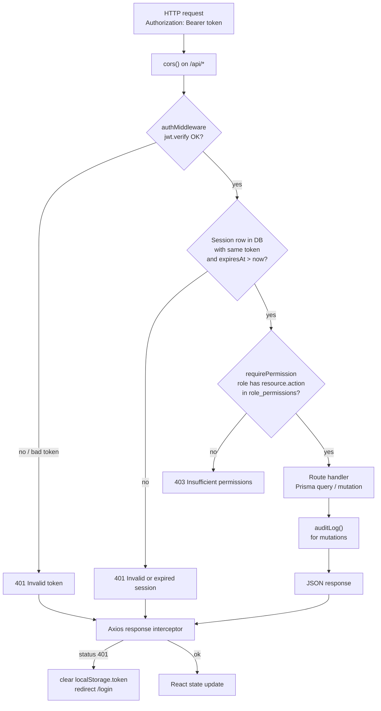
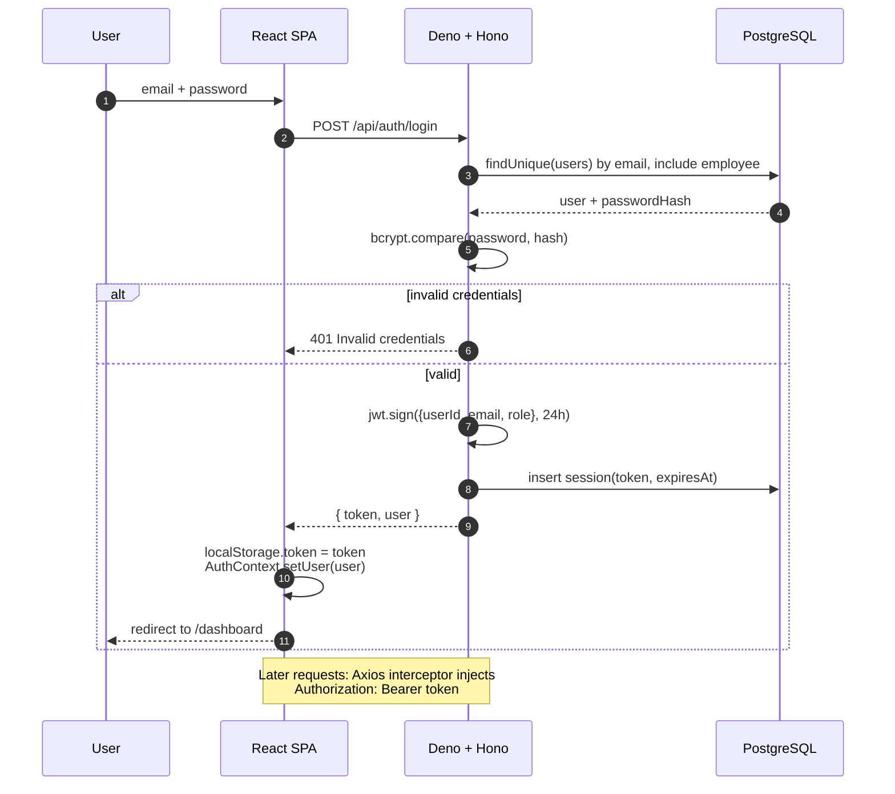
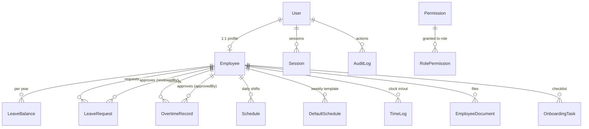
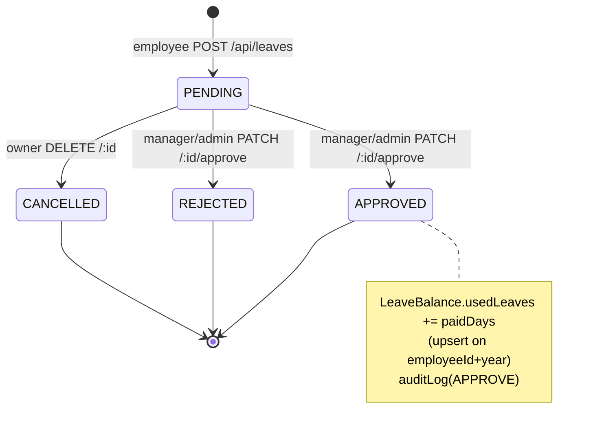
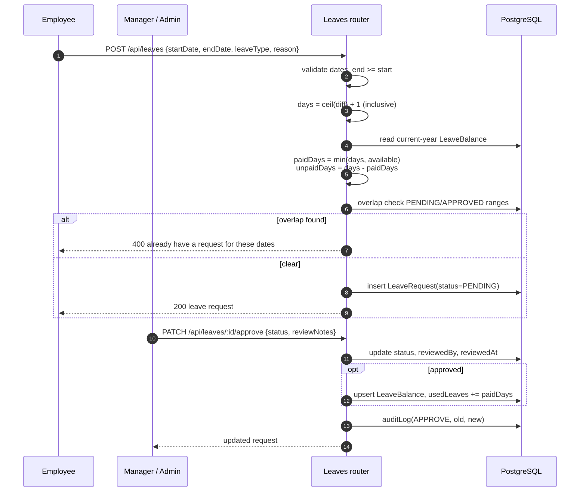
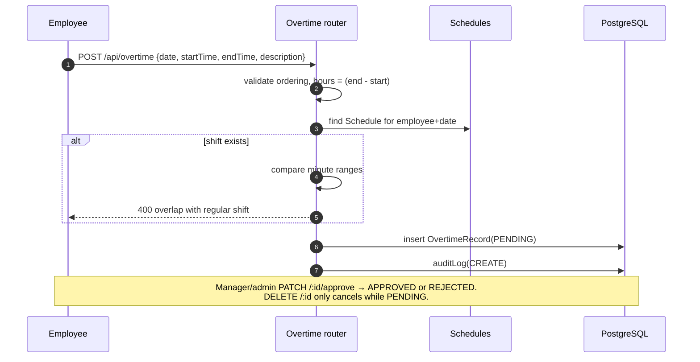
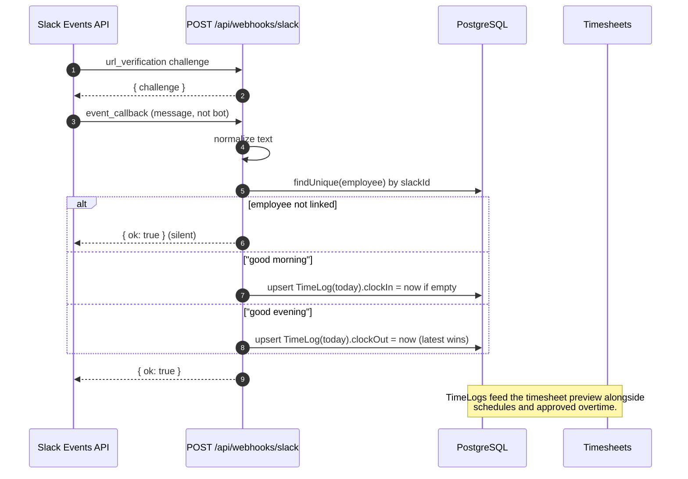
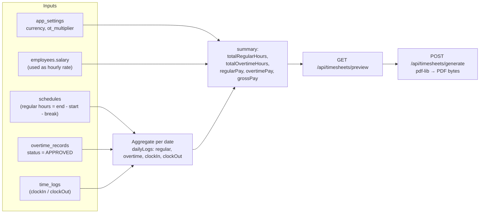
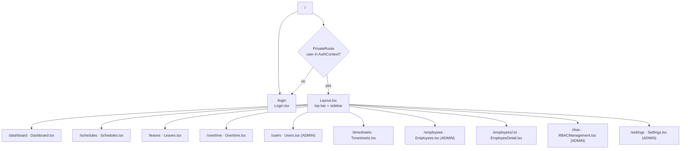

# Architecture & How It Works

Diagrams derived from the actual code (`backend/src`, `frontend/src`, `prisma/schema.prisma`).

## 1. High-level topology

- One Deno process serves both the JSON API and the built SPA (`backend/src/index.ts:121-127`).
- In dev, Vite proxies `/api` so the frontend and backend stay same-origin (`frontend/vite.config.ts`).

## 2. Request pipeline

Every `/api/*` router mounts `authMiddleware`, then per-endpoint permission checks.

Sessions are stored server-side (`sessions` table), so deleting the row invalidates the JWT immediately. Logout deletes the row (`backend/src/index.ts:100-106`).

## 3. Login / authentication

## 4. Domain model

Key tables and why they exist:

| Table | Role |
|---|---|
| `users` | Login identity: email, bcrypt hash, `role` enum, `isActive` |
| `employees` | HR record linked 1:1 to a user: code, department, position, hire date, salary, `slackId` |
| `leave_balances` | Per employee per year: `totalLeaves`, `usedLeaves` (unique on employee+year) |
| `leave_requests` | `PENDING → APPROVED/REJECTED/CANCELLED`, paid vs unpaid day split |
| `overtime_records` | Start/end + derived `hours`, approval trail |
| `schedules` | Concrete shift per employee per date (unique employee+date) |
| `default_schedules` | Weekly template (dayOfWeek 0-6) that generates `schedules` |
| `time_logs` | Slack-driven clockIn/clockOut, unique employee+date |
| `employee_documents` | Uploaded files + expiry/status |
| `onboarding_tasks` | Checklist per employee with progress counts |
| `sessions` | JWT allow-list / revocation |
| `audit_log` | Old/new JSON snapshots for mutations |
| `permissions` / `role_permissions` | Runtime RBAC, editable via `/api/rbac` |
| `app_settings` | Company name, currency, overtime multiplier, leave allowance |

## 5. Leave lifecycle

Balance accrual: `computeAccruedLeaves()` prorates the annual allowance (setting `leave.annual_allowance`) by days worked this year (`backend/src/routes/leaves.ts:15-41`).

## 6. Overtime lifecycle

## 7. Slack clock-in / clock-out

## 8. Timesheet generation

- Employees are forced to their own `employeeId` on preview, and `generate` rejects PDFs for other employees (`backend/src/routes/timesheets.ts:48-55,175-181`).
- `reports.view` gates preview; `reports.export` gates PDF generation.

## 9. Frontend routing & navigation

Providers wrapping the app (`frontend/src/App.tsx:34-66`): `NotificationProvider → AuthProvider → SettingsProvider`. `UIContext` exists but is not mounted.

Sidebar visibility is role-filtered in `Layout.tsx:18-33`; note this is cosmetic — the API enforces permissions independently.

## 10. Roles and permissions

Seed defines ~30 `resource.action` permissions (`backend/prisma/seed.ts`). Effective access is whatever rows exist in `role_permissions`, edited live via `/api/rbac` (admin-only).

| Capability | ADMIN | MANAGER | EMPLOYEE |
|---|---|---|---|
| Manage users / contractors | ✅ | — | — |
| Manage RBAC & settings | ✅ | — | — |
| View all leave / overtime | ✅ | ✅ | own only |
| Approve leave / overtime | ✅ | ✅ | — |
| Create leave / overtime | ✅ | ✅ | ✅ |
| Manage schedules & defaults | ✅ | ✅ | read own |
| Preview / export timesheets | ✅ | ✅ | own only |
| Documents / onboarding | ✅ | read | read own |
| View audit log | ✅ | — | — |

## 11. Things to know when reading the code

- `authMiddleware` runs a DB query per request (`sessions` lookup), and `requirePermission` runs another (`role_permissions`) — two extra round-trips per API call.
- `getEmployeeByUserId()` is duplicated in leaves, overtime, timesheets, and other routers rather than shared.
- `app_settings` is read unfiltered in a few handlers (`(prisma as any).appSettings`) because `AppSettings` has no generated type access pattern in those spots.
- Notification and UI contexts exist in the frontend but notifications are not yet wired to backend events.
